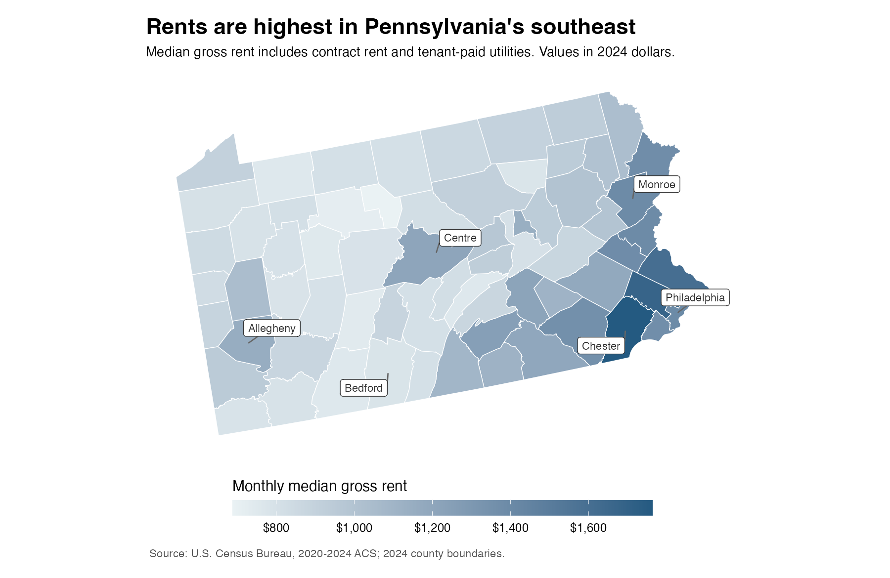
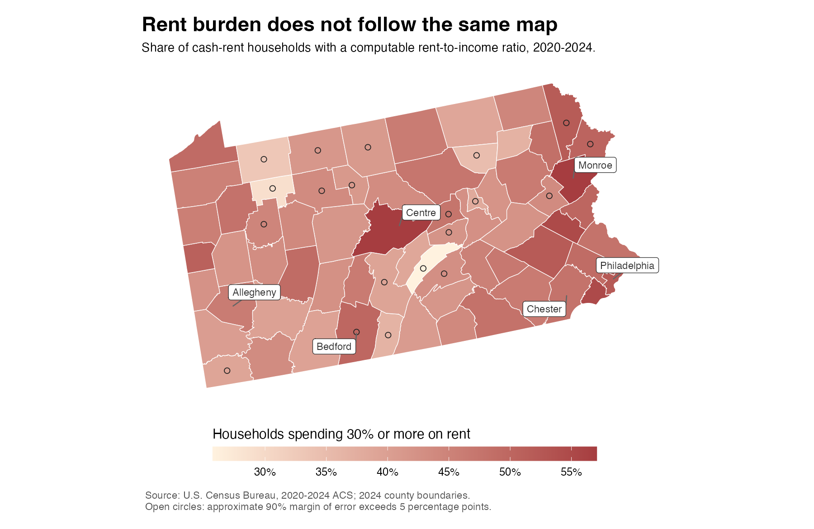
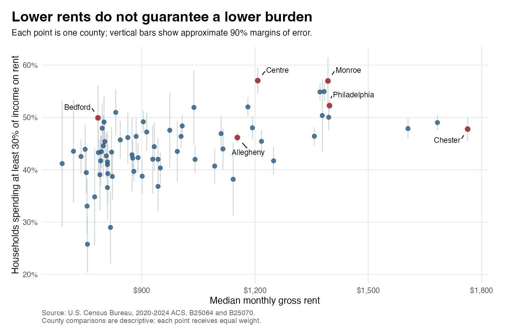
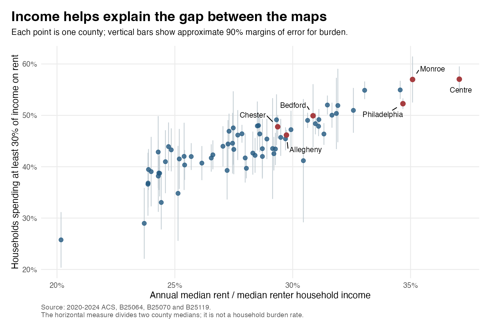

```{r}
#| include: false
library(readr)
library(dplyr)
library(scales)
county <- read_csv("data/processed/pa_county_rental_analysis.csv", show_col_types = FALSE)
headline <- read_csv("results/headline_results.csv", show_col_types = FALSE)
get_county <- function(name) county |> filter(.data$county == .env$name)
chester <- get_county("Chester")
centre <- get_county("Centre")
philadelphia <- get_county("Philadelphia")
bedford <- get_county("Bedford")
monroe <- get_county("Monroe")
allegheny <- get_county("Allegheny")
money <- function(x) dollar(x, accuracy = 1)
pct <- function(x) percent(x, accuracy = 0.1)
```

## When a lower rent is still hard to afford

Chester County's median monthly rent was `r money(chester$median_gross_rent)`. In Centre County, it was `r money(centre$median_gross_rent)`. Yet renters in Centre were more likely to spend at least 30% of their income on rent. The county with the smaller bill had the higher burden.

A lower rent may look attractive, but how far it goes depends on the income available to pay it. For local housing organizations, focusing only on expensive areas could also miss renters struggling elsewhere.

**Do Pennsylvania counties with lower rents generally have fewer renters spending a large share of their income on housing?** I compare all 67 counties to answer that question. The aim is to see how much the price of housing tells us, and what we miss when we stop there.

## From Census tables to county maps

I use the [2020–2024 American Community Survey](https://www.census.gov/programs-surveys/acs/data/summary-file.2024.html), which combines five years of survey data. These are estimates for that period, not current apartment listings. The rent measure is *median gross rent*: the middle monthly rent, including utilities paid separately by the tenant, expressed in 2024 dollars.

For affordability, I calculate the share of rent-paying households spending **30% or more of their income on rent and utilities**. I call this the rent-burden rate. Households whose ratio cannot be calculated are excluded. Across Pennsylvania, `r pct(headline$burden_rate_pooled)` of households with a calculable ratio met that threshold, and `r pct(headline$severe_burden_rate_pooled)` spent at least half their income on rent.

The R scripts download the official tables and match each county to its [Census map boundary](https://www.census.gov/geographies/mapping-files/time-series/geo/cartographic-boundary.html). The statewide shares combine household counts; they are not simple averages of county rates. The [data and methods notes](README.md) explain the calculations and how to reproduce the analysis.

## Where rents are higher

{#fig-rent}

Higher rents cluster in the southeast. Chester's median is `r money(chester$median_gross_rent)`, compared with `r money(philadelphia$median_gross_rent)` in Philadelphia. Much of western and central Pennsylvania has lower rents. Bedford's median is `r money(bedford$median_gross_rent)`, while Allegheny's is `r money(allegheny$median_gross_rent)`.

The first map shows where rents are higher. The next asks whether those are also the places where renters have the most trouble paying them.

## Housing pressure reaches beyond expensive counties

{#fig-burden}

Housing pressure is not confined to the highest-rent counties in the southeast. Centre, in central Pennsylvania, has a burden rate of `r pct(centre$burden_rate)`. Monroe, in the northeast, is at `r pct(monroe$burden_rate)`. Both have lower median rents than Chester, where the rate is `r pct(chester$burden_rate)`.

The contrast also appears closer to Philadelphia. Its rent is below Chester's, but its burden rate is higher, at `r pct(philadelphia$burden_rate)`. Farther west, Bedford combines a much lower rent with an estimated burden rate of `r pct(bedford$burden_rate)`. Bedford's estimate has a wider margin of error, so small differences between it and other counties should not be treated as firm rankings.

## What happens when we compare every county?

{#fig-comparison}

The broader pattern is still clear: higher-rent counties generally have higher burden rates. The correlation is `r number(headline$pearson_r, accuracy = 0.01)`, counting each county equally. The relationship is positive, but there is plenty of variation around it.

Centre and Chester illustrate that variation. Allegheny offers another comparison: its rent is close to Centre's, while its burden rate is lower, at `r pct(allegheny$burden_rate)`. Lower rents often go with lighter burdens, but rent alone does not tell us which county has a larger share of struggling renters.

## Income helps explain the difference

To see why the maps differ, I added median renter household income from [ACS table B25119](https://api.census.gov/data/2024/acs/acs5/groups/B25119.html). Centre's median renter income is `r money(centre$renter_income)` a year, compared with `r money(chester$renter_income)` in Chester. Centre's rent is lower, but its renter income is lower by much more.

Dividing annual median rent by median renter income gives `r pct(centre$rent_to_income)` for Centre and `r pct(chester$rent_to_income)` for Chester. Monroe's renter income is `r money(monroe$renter_income)`, putting its ratio at `r pct(monroe$rent_to_income)`. These comparisons help explain why housing pressure extends beyond the high-rent southeast: a smaller rent bill can still be large relative to local renters' incomes.

{#fig-income}

Across the 67 counties, this income-based comparison has a correlation of `r number(headline$income_ratio_r, accuracy = 0.01)` with the burden rate, compared with `r number(headline$pearson_r, accuracy = 0.01)` for rent alone. This is a ratio of two county medians, **not the share of income paid by a typical household**. The stronger relationship is also partly expected: both measures compare housing costs with income. It helps us read the maps, rather than proving what causes a county's burden rate.

Centre has an important local feature: Penn State's University Park campus. The county's [2023 Housing Needs Assessment](https://centrecountypa.gov/DocumentCenter/View/25310/Centre-County-2023-HNA_Final_6_20_2023#page=76) links high burden among its lowest-income renters to the concentration of college students. It also notes that resources such as student loans can complicate comparisons based on reported income. Students are therefore a plausible part of Centre's story, although these county totals cannot separate their contribution from that of other renters. Households with zero or negative income have noncomputable ratios and are excluded from my burden rate; they are not automatically counted as burdened.

## What should a renter take from this?

When comparing places to live, I would start with actual rent and utility costs, then compare them with the income I expected to have there. A county with cheaper housing may also offer lower earnings. For local housing organizations, the two maps together identify places worth examining more closely, including lower-rent counties where many households still struggle.

The ACS estimates cover 2020–2024, not today's listings, and county figures hide differences between neighborhoods and households. Error bars show uncertainty in the burden estimates; map circles flag margins above five percentage points. The rent measures exclude households paying no cash rent, while the added income measure covers all renter households. The 30% threshold offers a common comparison, but does not account for every household's other expenses.

## Takeaway

Lower rents generally go with lower rent burdens in Pennsylvania, but Centre and Monroe show why price alone can mislead. **Rent tells us what housing costs; renter income helps explain how hard it is to pay.** Renters should compare costs with their own expected income. Housing organizations should examine low renter incomes alongside high rents when deciding where to look more closely at housing needs.

---

*Sources: U.S. Census Bureau, 2020–2024 ACS, tables B25064, B25070 and B25119; 2024 county boundaries. [Data and methods](README.md) · [GitHub: code and data](https://github.com/liu118-oss/AEDS-6400-Blog/tree/main/posts/week-05) · [Download replication files](results/replication.zip).*
