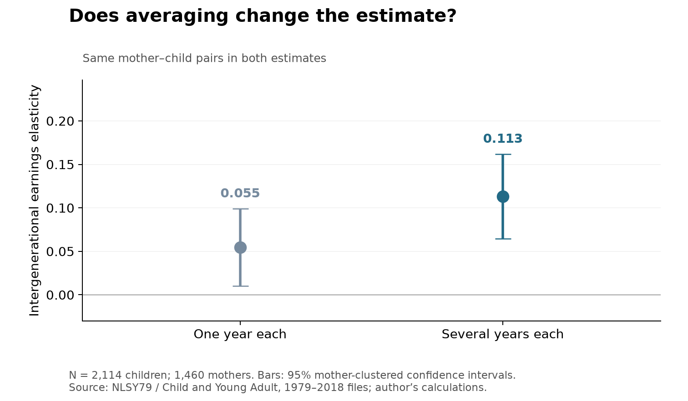
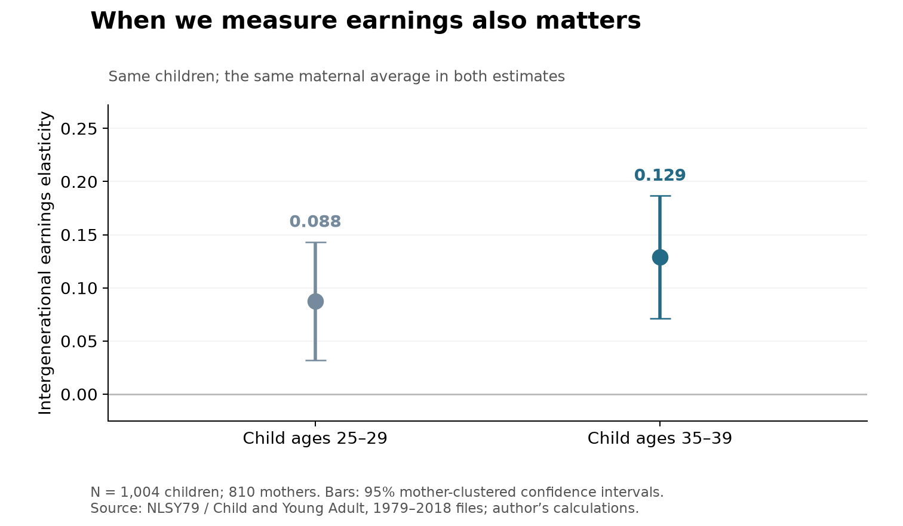

```{r}
#| include: false
est <- read.csv("results/estimates.csv")
flow <- read.csv("results/sample_flow.csv")
dif <- read.csv("results/differences.csv")
metrics <- read.csv("results/metrics.csv")
met <- function(key) as.numeric(metrics$value[metrics$metric==key])
e <- function(name, col="beta") est[est$model==name, col]
f3 <- function(x) sprintf("%.3f", x)
nice <- function(x) format(x, big.mark=",", scientific=FALSE, trim=TRUE)
```

## A first paycheck is only a starting point

**Would I reach the same conclusion about economic mobility if I measured someone's earnings at 27 instead of 37?** Someone in their twenties may still be finishing school or changing jobs. Their earnings may say more about that stage of life than their longer-run position. This matters when using mobility estimates to judge how family background shapes opportunity.

I use Python and SQL to match mothers with their adult children, then ask how the estimated earnings relationship changes when I average several years or measure the children later.

## Start with people, then income

I use the public [NLSY79 and Child/Young Adult files](https://www.bls.gov/nls/getting-started/accessing-data.htm) covering 1979–2018. The child file provides a mother's ID, which connects to her record in NLSY79. The original files contain `r nice(flow$children[1])` children; every child has a matching mother.

Here, “income” means annual earnings from wages, salaries, commissions and tips, rather than total household resources. I convert amounts to 2018 dollars using the [BLS Consumer Price Index](https://www.bls.gov/cpi/data.htm). Negative survey codes mean missing information; a reported zero is a real observation.

To follow along, install the dependencies and run the scripts from this post's folder:

```bash
python -m pip install -r requirements.txt
python code/analyze.py
python code/plot.py
```

The repository includes compact extracts, so downloading the large originals is optional. The [README](README.md) explains both routes, the variable names and the income reference years. The code, extracts and results are available in the [GitHub repository](https://github.com/liu118-oss/AEDS-6400-Blog/tree/main/posts/week-06).

## Match the two generations with SQL

The first script creates a SQLite database. Open it in Python and match the IDs:

```python
import sqlite3
import pandas as pd

con = sqlite3.connect("data/analysis.sqlite")
matched = pd.read_sql_query("""
    SELECT c.child_id, c.mother_id
    FROM children AS c
    JOIN mothers AS m ON c.mother_id = m.mother_id
    WHERE m.sex = 2
""", con)
```

`SELECT` chooses the columns to return. `JOIN` connects records with the same mother ID; it does not match people by row order. Several children can share one mother, so the matched table keeps one row per child.

The IDs tell me who belongs to which family. Next, I need an earnings measure for each person. Instead of letting one unusually good or bad year represent a mother's earnings, I average her available observations between ages 30 and 44:

```python
mother_average = pd.read_sql_query("""
    SELECT person_id AS mother_id,
           AVG(wage_real) AS mother_mean,
           COUNT(*) AS mother_n
    FROM earnings
    WHERE cohort = 'mother' AND age BETWEEN 30 AND 44
    GROUP BY person_id
    HAVING COUNT(*) >= 3 AND AVG(wage_real) > 0
""", con)
```

`WHERE` selects the relevant records. `GROUP BY` gathers each mother's years together. `AVG` and `COUNT` are aggregations: they produce her average earnings and number of observations. `HAVING` keeps groups with at least three valid years and a positive average. Average the dollar amounts first, then take logs.

The script repeats this step for children at ages 25–34 and joins both averages back to the matched IDs. Zeros remain in these averages. For the single-year comparison, it selects the valid observation nearest age 37 for mothers and 30 for children, choosing the earlier year in a tie. Pairs with zero selected earnings are excluded because their logarithms are undefined; both estimates then use exactly the same pairs.

## One year versus several years

An **intergenerational earnings elasticity**, or IGE, is the slope from regressing log child earnings on log maternal earnings. An elasticity of 0.10 means that 10% higher maternal earnings are associated with approximately 1% higher child earnings. It describes an association, not a causal effect.

```python
import numpy as np

pairs = pd.read_csv("data/matched_averaging.csv")
x = np.log(pairs["mother_mean"])
y = np.log(pairs["child_mean"])
X = np.column_stack([np.ones(len(x)), x])
intercept, ige = np.linalg.lstsq(X, y, rcond=None)[0]
```

Use `mother_one` and `child_one` to estimate the single-year version. The script clusters uncertainty by mother because siblings share a family.



With one year of earnings, the estimated relationship is **about half as strong** as with several years (`r sprintf("%.0f%%", 100 * e("single") / e("average"))`). The families have not changed; the way I measure their earnings has. Among `r nice(e("single", "n"))` pairs, the estimate rises from `r f3(e("single"))` to `r f3(e("average"))`.

A year of unemployment, changing hours or a bonus can shift someone's earnings. Averaging reduces the influence of these temporary changes and can better reflect their longer-run position. The typical pair contributes `r nice(met("main_median_mother_years"))` maternal years and `r nice(met("main_median_child_years"))` child years. These estimates describe mothers' own earnings, which capture only part of a family's resources; they should not be read as estimates of overall family-income mobility.

## Measuring later in a career

Averaging and choosing an age address different problems. Several early-career years can still give an incomplete picture of later earnings. This is **life-cycle bias**: earnings measured at one age need not reflect the relationship between the generations' lifetime earnings.

Someone who stays in education may earn little at first and more later. If earnings paths differ across family backgrounds, averaging early earnings alone will not fix the timing problem.

For this check, I hold maternal average earnings fixed and select each child's earnings nearest ages 27 and 37, within ages 25–29 and 35–39. The same `r nice(e("young", "n"))` children appear in both estimates. [Interviews become less frequent after age 30](https://www.nlsinfo.org/content/cohorts/nlsy79-children/intro-to-the-sample/sample-design), so this comparison uses one observation in each age window.



The estimate is higher when I measure the same children later, rising from `r f3(e("young"))` to `r f3(e("older"))`. But the difference is uncertain: its 95% confidence interval runs from `r f3(dif$lower[2])` to `r f3(dif$upper[2])`, including zero. This fits the idea that early-career earnings can miss part of the longer-run relationship, but this sample cannot say exactly how much.

| Sample check | Children |
|:--|--:|
| Matched to mothers | `r nice(flow$children[2])` |
| Eligible averages in both generations | `r nice(flow$children[3])` |
| Positive single-year earnings in both generations | `r nice(flow$children[4])` |
| Positive earnings at both younger and older ages | `r nice(flow$children[6])` |

These are unweighted estimates for selected wage earners, not all American families. The older children disproportionately come from mothers who gave birth young. Missing interviews, top-coded high earnings and the exclusion of zero single-year earnings also limit the comparison. Calendar year changes alongside age, and neither age window measures lifetime earnings.

## Takeaway

**Before comparing two mobility estimates, check how earnings were measured.** In this sample, using several years produces a stronger mother–child earnings relationship than using one year. Measuring children later also raises the estimate, although that difference is less certain. The useful lesson is to look beyond the headline number: whose earnings, which ages, and how many years?

## Data sources

Bureau of Labor Statistics, U.S. Department of Labor. *National Longitudinal Survey of Youth 1979 cohort, 1979–2018 (rounds 1–28)*. Produced and distributed by the Center for Human Resource Research, The Ohio State University. Columbus, OH: 2021. [https://www.bls.gov/nls/nlsy79.htm](https://www.bls.gov/nls/nlsy79.htm).

Bureau of Labor Statistics, U.S. Department of Labor, and National Institute for Child Health and Human Development. *Children of the NLSY79, 1979–2018*. Produced and distributed by the Center for Human Resource Research, The Ohio State University. Columbus, OH: 2021. [https://www.bls.gov/nls/nlsy79-children.htm](https://www.bls.gov/nls/nlsy79-children.htm).

U.S. Bureau of Labor Statistics. *Consumer Price Index for All Urban Consumers: All Items in U.S. City Average* (CUUR0000SA0). [https://data.bls.gov/timeseries/CUUR0000SA0](https://data.bls.gov/timeseries/CUUR0000SA0). Accessed October 2026.
