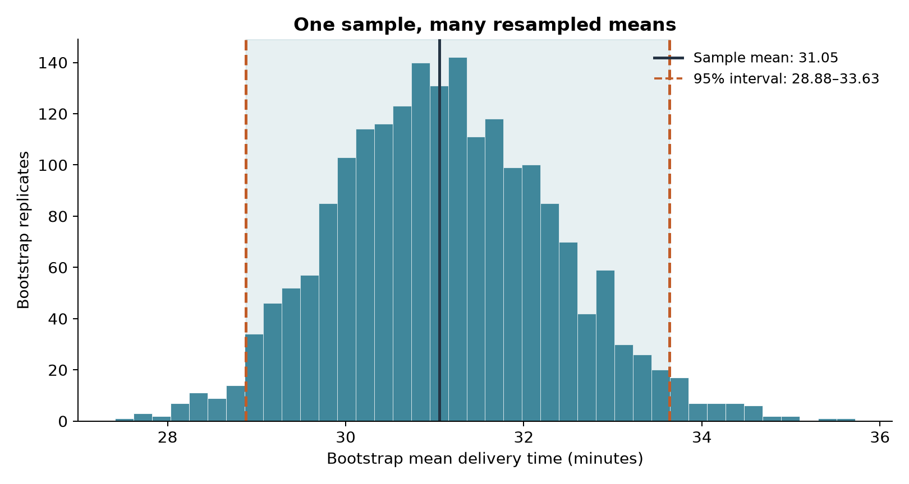

```{r}
#| include: false
metrics <- read.csv("results/metrics.csv")
m <- function(key) metrics$value[metrics$metric == key]
f <- function(key, digits=2) formatC(m(key), format="f", digits=digits)
pc <- function(key) sprintf("%.1f%%", 100*m(key))
```

## Can one batch of orders settle the question?

A delivery service says its average wait is 30 minutes. My orders take a little longer. **Is the claim wrong, or did I happen to observe a slow batch?** Before treating a sample average as an answer, I need to know how much it could vary.

The same problem shows up whenever a firm advertises an average: a delivery guarantee, a hospital's waiting time, a call center's response time. Customers, competitors and regulators usually see only a sample. Accusing a company of overstating its speed after one slow week is as risky as trusting the claim blindly. Statistical inference gives a rule for deciding when a gap between a sample and a claim is too large to be luck.

I use a hypothetical delivery service to explore that uncertainty. The data are simulated, not real orders. That lets me know the true average and check whether my statistical methods recover it. Three figures connect resampling, confidence intervals and hypothesis testing to the same question.

## A population I can check

I generate positive, right-skewed delivery times: most orders arrive sooner, but some take much longer. The model is lognormal, with a mean of 30 minutes and a standard deviation of 15. These are teaching assumptions, not estimates about a company. Orders are independent in this model.

I first draw 200 orders. Their average is `r f("example_mean")` minutes, even though the population mean is 30. Sampling alone creates a difference. The [code and saved data](https://github.com/liu118-oss/AEDS-6400-Blog/tree/main/posts/week-08) use fixed random seeds; the [README](README.md) gives the reproduction steps.

## Resampling the orders I observed

A **bootstrap** asks how the estimate varies when I resample the observed orders. I draw 200 values with replacement, so an order can appear more than once, and calculate their average. Repeating this 2,000 times produces the distribution below.



The middle 95% of these means runs from `r f("bootstrap_lower")` to `r f("bootstrap_upper")` minutes. Those endpoints form a **percentile bootstrap confidence interval**. The spread gives a sense of uncertainty around my estimate; it does not describe where 95% of individual delivery times fall.

Resampling adds no new orders. It uses the sample as a stand-in for the population, so an unrepresentative sample can still produce a misleading interval.

## What does “95%” actually mean?

To check coverage, I now draw entirely new samples from the known population. For each one, I repeat the bootstrap procedure and record whether its interval contains 30. I do this 1,000 times for each sample size.

```{=html}
<iframe src="results/02_coverage.html" title="Interactive confidence interval coverage by sample size and confidence level" style="width:100%;height:890px;border:0;" loading="lazy"></iframe>
```

*Each line is an interval; each dot is its sample mean. Blue intervals contain 30, orange intervals miss it. The display shows the first 100 experiments; summaries use all 1,000. Source: author's simulation.*

With 200 orders, the nominal 95% intervals cover the truth in `r pc("coverage_200")` of experiments; with 500, coverage is `r pc("coverage_500")`. These are close to, but not exactly, 95%. At 200 orders, simulation uncertainty alone is about `r sprintf("%.1f",100*m("mc_se_200"))` percentage points as a standard error. Percentile intervals can also under-cover in finite, skewed samples.

Try raising confidence from 95% to 99% while keeping sample size fixed: the intervals widen. Then hold confidence at 95% and increase the sample size. Average width falls from `r f("width_50")` minutes at 50 orders to `r f("width_500")` at 500. More data improve precision; they do not turn a 95% procedure into a 99% procedure.

The 95% label describes repeated use of the method. It does not mean that, after an interval is calculated, there is a 95% probability that the fixed population mean lies inside that particular interval.

## What if the 30-minute claim were true?

My first batch, averaging `r f("example_mean")` minutes, could not rule out 30: its interval runs from `r f("bootstrap_lower")` to `r f("bootstrap_upper")`. That is the right answer, because that batch really came from a 30-minute service. Now suppose the service has quietly slowed down. I generate a second, separate batch of 200 orders from a population with mean 33, keeping the same distributional shape. This alternative is specified before seeing the result. Its observed mean is `r f("observed_mean")` minutes. Can a test detect the slowdown?

The **null hypothesis** says the mean is 30. Under that claim and the assumed lognormal shape, I simulate 10,000 samples of 200 orders. Their means form the null distribution. The test is two-sided: unusually low or high means count against the claim.


The rejection boundaries are approximately `r f("critical_lower")` and `r f("critical_upper")` minutes, leaving about 2.5% in each tail. The observed mean lies beyond the upper boundary, inside the orange region. The right panel asks a different question: how often does a 30-minute service produce a batch this slow? Only `r m("right_count")` of 10,000 simulated batches reach `r f("observed_mean")` minutes. Doubling that tail for a two-sided test, with a small finite-simulation correction, gives a p-value of `r f("p_value",3)`. Because it is below 0.05, I reject the specified null model at the 5% level. The two panels always agree: an observed mean lands in the rejection region exactly when its p-value is below 5%.

What does the 5% actually buy? I rerun the whole test on 5,000 fresh batches. When the 30-minute claim is true, it wrongly rejects in `r pc("reject_rate_null")` of batches, close to the 5% the rejection region was built for. When the true mean is 33, it correctly rejects in `r pc("reject_rate_alternative")`; this is the test's **power**. So roughly one in four batches from the slower service would *not* trigger a rejection. A slowdown can be real yet go undetected in a single batch of 200 orders.

This p-value measures how unusual the result is under the null model, not the probability that the claim is true. Failing to reject would not prove the claim either. Here the test also assumes the distribution's shape; real delivery data could violate that assumption or contain related delays across orders.

## Takeaway

**One batch gives an estimate, not certainty.** Resampling shows uncertainty around that estimate; repeated experiments reveal how often intervals capture the truth; a null simulation tests a particular claim, and repeating that test shows it is wrong about 5% of the time when the claim holds and can still miss a real slowdown. Before acting on an average, I would ask how many observations support it, how wide its interval is, and which assumptions make the comparison credible.

## Data and references

Data: author's simulated delivery times, generated November 2, 2026. No real company or customer records are used. Assumptions and seed are in [parameters.json](data/parameters.json).

Method references: [UC Berkeley, Bootstrap percentile intervals](https://stat135.berkeley.edu/fall-2026/Modules/12-Bootstrap.html); NIST/SEMATECH e-Handbook, [Confidence limits for the mean](https://itl.nist.gov/div898/handbook/eda/section3/eda352.htm) and [Critical values and p-values](https://itl.nist.gov/div898/handbook/prc/section1/prc131.htm).
